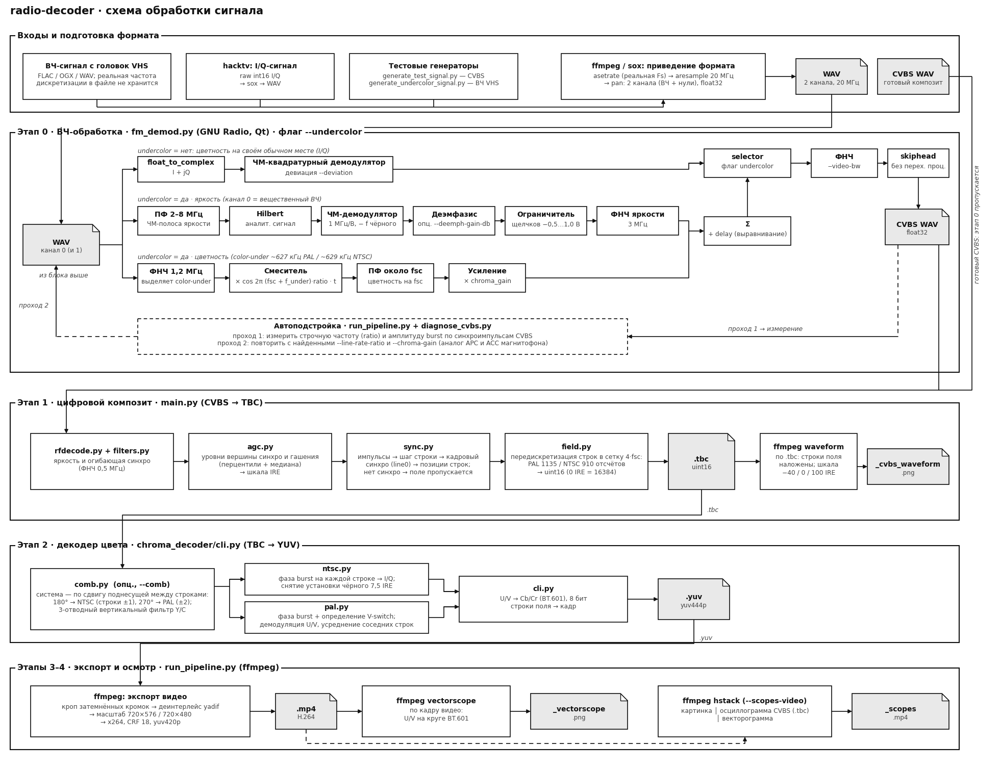
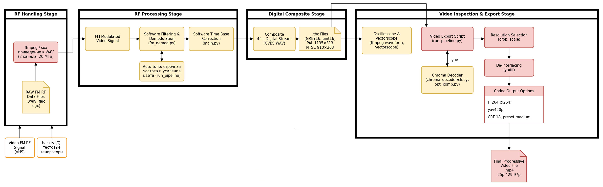
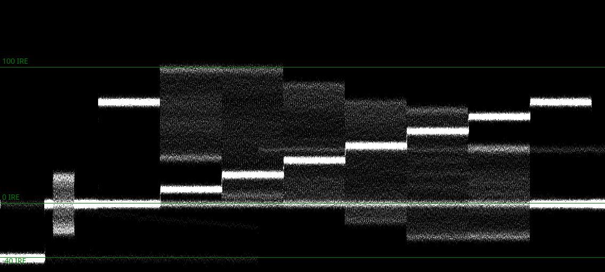
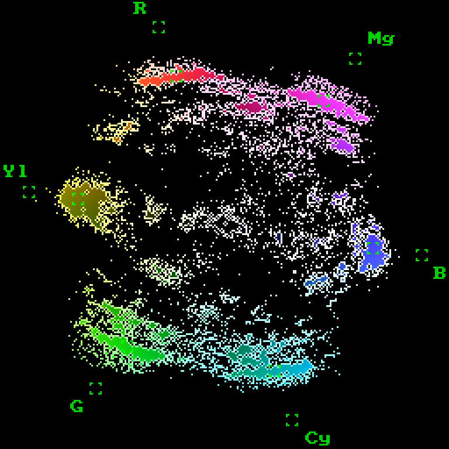
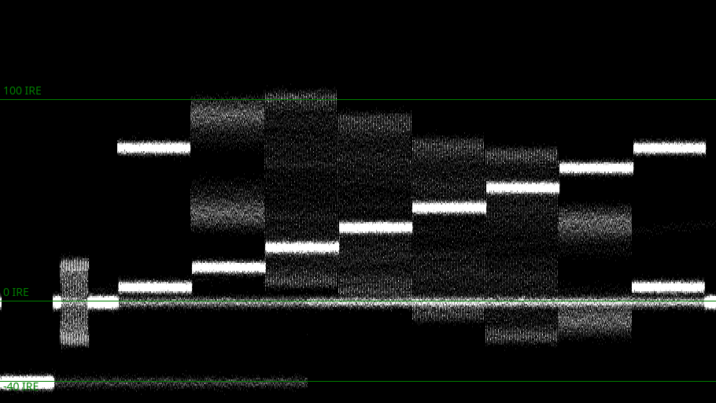
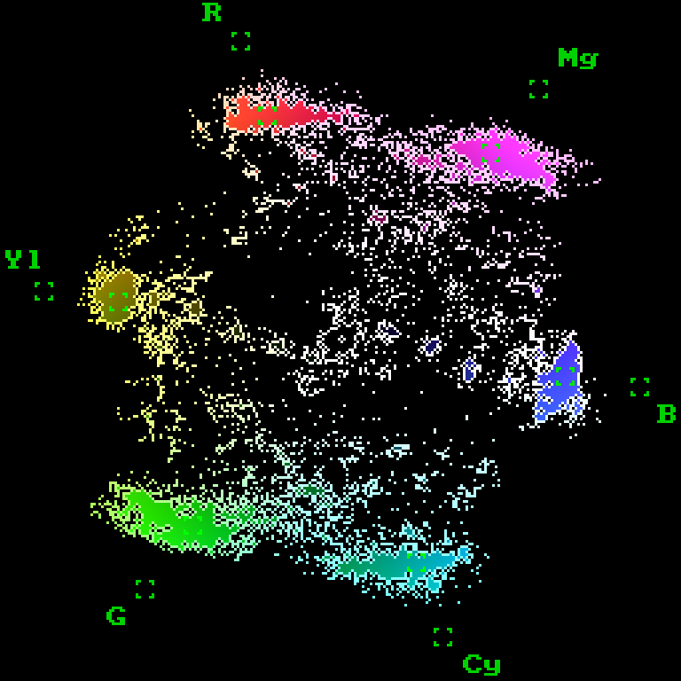

# radio-decoder

## 1. О проекте

Декодер аналогового телевидения на Python (NumPy/SciPy). Из записи **композитного видеосигнала (CVBS)** или **ЧМ-модулированного ВЧ-сигнала** (запись головок VHS, эфир, LaserDisc) получается цветной видеофайл.

**Видеосистемы:** PAL (625 строк, 50 полей/с, fsc 4,43361875 МГц) и NTSC (525 строк, 59,94 поля/с, fsc 3,579545 МГц).

**Режимы записи цветности:**

| Режим | Где цветность в сигнале | Типичный источник | Как включить |
|---|---|---|---|
| обычный | на поднесущей fsc внутри композита | эфир, LaserDisc, CVBS-записи | по умолчанию |
| `undercolor` | под ЧМ-яркостью, ~627 кГц (PAL) / ~629 кГц (NTSC) | VHS и другие color-under форматы | `--undercolor` в `fm_demod.py` и `run_pipeline.py` |

**Зависимости:** Python 3.9+, `numpy`, `scipy` (`pip install -r requirements.txt`); `ffmpeg` в `PATH` (этапы экспорта и осциллограммы); GNU Radio 3.10 с Qt (`PyQt5`) нужен только для `fm_demod.py`. Для подготовки сигналов из обычных видео дополнительно нужны `hacktv` и `sox`, для анализа частоты дискретизации - `ffprobe` (входит в состав ffmpeg).

## 2. Оглавление

1. [О проекте](#1-о-проекте)
2. [Оглавление](#2-оглавление)
3. [Графические схемы](#3-графические-схемы)
4. [Архитектура](#4-архитектура)
5. [Источники сигналов](#5-источники-сигналов)
6. [Поддерживаемые форматы](#6-поддерживаемые-форматы)
7. [Основные команды и флаги](#7-основные-команды-и-флаги)
8. [Бенчмарк и тестирование](#8-бенчмарк-и-тестирование)
9. [Limitations](#9-limitations)
10. [Полезные ссылки](#10-полезные-ссылки)

## 3. Графические схемы

На первой схеме показан полный путь данных: от входного файла до итогового `.mp4` и отладочных картинок, с разбивкой по этапам 0-4.



На второй схеме - то же в упрощённом виде.




## 4. Архитектура

```
radio-decoder/
├── run_pipeline.py                 все этапы одной командой + осциллограмма/векторограмма
├── fm_demod.py                     этап 0: ЧМ-демодулятор (GNU Radio, Qt, --headless)
├── main.py                         этап 1: CVBS -> TBC
├── decoder.py                      CVBSDecoder: выбор параметров системы, цикл по полям
├── rfdecode.py                     RFDecode: исходный сигнал и версия после ФНЧ 0,5 МГц
├── filters.py                      коэффициенты ФНЧ 0,5 МГц
├── agc.py                          уровни синхро и гашения, масштаб в 16-битные коды
├── sync.py                         синхроимпульсы, line0, linelocs
├── field.py                        FieldCVBS: ресемплинг поля в сетку 4·fsc
├── inout.py                        чтение WAV/сырых файлов, запись .tbc
├── constants.py                    параметры PAL/NTSC, VHS_UNDERCOLOR
├── chroma_decoder/                 этап 2: TBC -> YUV
│   ├── cli.py                      CLI, флаг --comb
│   ├── pal.py                      PAL: фаза burst, V-switch, усреднение соседних строк
│   ├── ntsc.py                     NTSC: фаза burst, I/Q, снятие 7,5 IRE
│   ├── comb.py                     гребенчатый Y/C-фильтр
│   └── _bench_quality.py           оценка цвета для benchmark.py (JSON)
├── diagnose_cvbs.py                диагностика записи: уровни, SNR, синхро, строчная частота
├── benchmark.py                    скорость и качество цвета
├── generate_test_signal.py         синтетический CVBS PAL/NTSC
├── generate_undercolor_signal.py   эмулятор ВЧ-записи color-under
├── docs/img/                       схемы и результаты бенчмарка для README
├── samples/                        I/Q и ВЧ-записи (в git не хранятся)
├── test_signals/                   готовый CVBS для проверки (в git не хранится)
├── constants.py  requirements.txt  README.md
```

| Модуль | Назначение |
|---|---|
| `fm_demod.py` | GNU Radio flowgraph с Qt-окном. Вход - 2-канальный WAV. FM-демодуляция в базовом случае, если --undercolor - яркость и цветность разделяются на два пути: яркость демодулируется, цветность переносится на нужную частоту и усиливается, после чего обе части складываются. В конце лишний переходный хвост от фильтров отбрасывается, и результат пишется в WAV. |
| `main.py` | Этап 1. Читает вход, создаёт `CVBSDecoder`, декодирует поле за полем и дописывает их в `.tbc` |
| `decoder.py` | `CVBSDecoder`: подбирает параметры системы, для каждого фрагмента входа создаёт `FieldCVBS` |
| `rfdecode.py` | `RFDecode`: получает сигнал и его версию после ФНЧ 0,5 МГц, по ней ищется синхро |
| `filters.py` | Коэффициенты ФНЧ для `RFDecode` |
| `agc.py` | Уровни синхро и гашения (медиана по несглаженному сигналу), масштаб: 0 IRE = 16384, 1 IRE = 327,68 |
| `sync.py` | Поиск синхроимпульсов, длина строки, позиция первой строки (`line0`), позиции всех строк (`linelocs`) |
| `field.py` | Ресемплинг поля по позициям строк в сетку 4·fsc |
| `inout.py` | Чтение WAV и сырых файлов, запись `.tbc` |
| `constants.py` | Параметры PAL/NTSC (строки, fsc, длительности, IRE, геометрия TBC) и `VHS_UNDERCOLOR` |
| `chroma_decoder/cli.py` | Этап 2. Читает `.tbc`, декодирует цвет, переводит U/V в BT.601, пишет `.yuv` |
| `chroma_decoder/pal.py` | Фаза burst на каждой строке, определение V-switch по межстрочному приращению фазы, демодуляция U/V с усреднением соседних строк |
| `chroma_decoder/ntsc.py` | Фаза burst, демодуляция I/Q с разной полосой, снятие установки чёрного 7,5 IRE |
| `chroma_decoder/comb.py` | Гребенчатый фильтр. Строки ±1 для NTSC (сдвиг 180°), ±2 для PAL (сдвиг 270°) |
| `run_pipeline.py` | Склеивает этапы 0-4, печатает тайминги, строит осциллограмму (`waveform`) и векторограмму (`vectorscope`) |
| `diagnose_cvbs.py` | По окнам печатает уровни синхро и гашения, SNR, число и шаг синхроимпульсов, вердикт; оценивает строчную частоту и амплитуду burst |
| `benchmark.py` | Время этапов, real-time фактор и метрика цвета для PAL/NTSC, с `--comb` и без |
| `generate_test_signal.py` | Синтетический CVBS: синхро, burst, цветные полосы, серые градации, шум, wow/flutter, строчный джиттер |
| `generate_undercolor_signal.py` | CVBS -> ЧМ-яркость + перенесённая цветность -> ВЧ-WAV для `fm_demod.py --undercolor`. |

## 5. Источники сигналов

### 5.1 Готовые записи

Записи сигналов брал из общедоступных ресурсов:

**Google Drive:** [архив собран командой vhs-decode/ld-decode](https://drive.google.com/drive/u/1/folders/1lzQWdFFfVclEQUDbuwngro0MCusOgPM6)

**Интернет архивы:** [можно найти на archive.org, пользуясь поисковиком](https://archive.org/search?query=ld-decode+NTSC+RF&tab=all)

**Синтетические сигналы для тестирования**
| Файл | Система | Режим | Тип | Fs, МГц | Длит., с | Как получен / команда |
|---|---|---|---|---|---|---|
| `test_signals/test_pal_cvbs.wav` | PAL | обычный | CVBS, float32 | 17,734475 | 1 | `generate_test_signal.py` |
| `test_signals/test_ntsc_cvbs.wav` | NTSC | обычный | CVBS, float32 | 14,318182 | 1 | `generate_test_signal.py` |
| `test_signals/test_pal_undercolor_rf.wav` | PAL | undercolor | ВЧ, float32, 2 кан. | 20 | 0,5 | `generate_undercolor_signal.py -s PAL` |

### 5.2 Перевод в WAV и проверка частоты
 
**Файлы FLAC и OGX** переводятся в WAV через `ffmpeg`. Частота дискретизации и число каналов сохраняются:
 
```bash
ffmpeg -i input.flac -c:a pcm_f32le output.wav
```
 
Для 16-битного WAV используйте `-c:a pcm_s16le`.
 
**Частоту дискретизации** проверяйте через `ffprobe`:
 
```bash
ffprobe input.wav
```
 

### 5.3 Обычное видео → сигнал: hacktv + sox
 
[hacktv](https://github.com/fsphil/hacktv) делает из видео радиосигнал аналогового ТВ и записывает его как сырые I/Q. Этот путь подходит только для обычного ЧМ-сигнала, без `--undercolor`, так как hacktv не умеет генерировать color-under.
 
**Шаг 1. Видео -> сырой I/Q.** hacktv кодирует видео в ВЧ-сигнал PAL с частотной модуляцией. Числа записываются как 16-битные целые (`-t int16`) с частотой 20 МГц (`-s 20000000`). В файле нет заголовка, поэтому частоту и формат нужно передавать явно.
 
```bash
hacktv -o file:my_pal.iq -t int16 -s 20000000 -m pal-fm my_video.mp4
```
 
Все режимы и опции: `hacktv --help`.
 
**Шаг 2. Сырой I/Q -> WAV.** sox добавляет заголовок. Параметры должны совпадать с настройками hacktv: частота 20 МГц, знаковые 16-битные числа, два канала (I и Q).
 
```bash
sox -t raw -r 20000000 -e signed -b 16 -c 2 my_pal.iq samples/my_pal_iq.wav
```
 
**Шаг 3. WAV -> видео.** `run_pipeline.py` демодулирует частоту, разбирает картинку на строки и поля и сохраняет mp4. Флаг `--fm-deviation` должен совпадать с девиацией, которую использовал hacktv. Если значения расходятся, картинка будет искажена или не декодируется.
 
```bash
python3 run_pipeline.py samples/my_pal_iq.wav out_pal.mp4 -s PAL --from-iq --fm-deviation <девиация, МГц>
```
 
### 5.4 Один канал → два канала (только для `--undercolor`)
 
Если у вас есть моно-запись ВЧ, sox делает из неё стерео, дублируя канал:
 
```bash
sox rf_mono.wav -c 2 samples/rf_2ch.wav remix 1 1
```
 
Это подходит только для `--undercolor`, где используется канал 0, а второй не читается. Для обычного ЧМ-режима I и Q должны быть разными каналами, и дублирование даст неправильную демодуляцию.
 
### 5.5 Демодулированный композит (CVBS)
 
Если уже есть WAV с композитным сигналом, этап демодуляции не нужен.  `run_pipeline.py` без `--from-iq`:
 
```bash
python3 run_pipeline.py input.wav output.mp4 -s PAL
```
 
Частота дискретизации должна быть не ниже 4·fsc: около 17,73 МГц для PAL и около 14,32 МГц для NTSC.


## 6. Поддерживаемые форматы

### 6.1 Видеостандарты

| Параметр | PAL | NTSC |
|---|---|---|
| Строк в кадре | 625 | 525 |
| Строк в поле (активных) | 312,5 / 288 | 262,5 / 240 |
| Полей в секунду | 50 | 59,94 |
| Строчная частота | 15 625 Гц | 15 734 Гц |
| Длительность строки | 64 мкс | 63,56 мкс |
| Поднесущая fsc | 4,43361875 МГц | 3,579545 МГц |
| Уровень синхро | -40 IRE | -40 IRE |
| Установка чёрного | 0 IRE | 7,5 IRE |
| Burst | 43 IRE (размах) | 40 IRE (размах) |
| Отсчёты TBC (4·fsc) | 1135 × 313 | 910 × 263 |
| Итоговый размер кадра | 720 × 576 | 720 × 480 |
| Частота кадров итога | 25 | 29,97 |

### 6.2 Носители и способы записи

| Носитель / формат | Система | Что на входе | Цветность | Яркость | Как подать |
|---|---|---|---|---|---|
| Эфир, ТВ-выход, CVBS-оцифровка | PAL, NTSC | CVBS WAV | на fsc (обычный) | композит | `run_pipeline.py input.wav` |
| LaserDisc (композит) | PAL, NTSC | CVBS WAV | на fsc (обычный) | композит | по схеме CVBS | как CVBS; ВЧ-вариант не проверялся |
| VHS (color-under) | PAL | ВЧ-WAV, I/Q или CVBS | ~627 кГц под ЧМ | ЧМ, несущая 3,8 МГц на синхро | `--from-iq --undercolor --system pal` |
| VHS (color-under) | NTSC | ВЧ-WAV | ~629 кГц под ЧМ | ЧМ, несущая 3,4 МГц на синхро | `--from-iq --undercolor` |
| Сырые ВЧ/I-Q от hacktv | PAL (`pal-fm`) | I/Q int16 -> WAV | обычный | ЧМ, девиация 5 МГц | `--from-iq --fm-deviation` |


## 7. Основные команды и флаги

### 7.1 Весь конвейер - `run_pipeline.py`

```bash
python3 run_pipeline.py input.wav output.mp4 -s PAL                       # CVBS -> mp4 + осциллограмма + векторограмма
python3 run_pipeline.py iq.wav output.mp4 -s PAL --from-iq --fm-deviation 4.5
python3 run_pipeline.py head_rf.wav output.mp4 -s NTSC --from-iq --undercolor
python3 run_pipeline.py input.wav output.mp4 -s NTSC --comb --scopes-video
python3 run_pipeline.py samples/vhs_rf.wav out.mp4 -s NTSC --from-iq --undercolor --scopes-video
```

| Флаг | Назначение | По умолчанию |
|---|---|---|
| `input` `output` | входной `.wav` / выходной `.mp4` | - |
| `-s {PAL,NTSC}` | видеосистема | `PAL` |
| `-f N` | сколько кадров декодировать | весь файл |
| `-r МГц` | частота дискретизации входа | из заголовка WAV |
| `--comb` | Y/C-разделение гребенчатым фильтром | выкл. (полосовой фильтр) |
| `--deinterlace {yadif,w3fdif,none}` | деинтерлейс | `yadif` |
| `--no-scopes` | не строить осциллограмму и векторограмму | выкл. (строятся) |
| `--scopes-video` | дополнительно `<имя>_scopes.mp4`: картинка, осциллограмма и векторограмма рядом | выкл. |
| `--scope-frame N` | кадр для `.png` | середина файла |
| `--from-iq` | вход - запись до ЧМ-демодуляции; сначала запускается `fm_demod.py` | выкл. |
| `--fm-deviation МГц` / `--fm-video-bw МГц` | девиация и полоса ФНЧ для `fm_demod.py` (только с `--from-iq`) | 5 / 6 |
| `--undercolor` | цветность под яркостью (только с `--from-iq`) | выкл. |

Осциллограмма CVBS строится по `.tbc` фильтром `waveform` (все строки поля наложены, видны синхро, burst и активная часть; шкала -40/0/100 IRE). Векторограмма строится по готовому видео фильтром `vectorscope` (U/V на круге BT.601).

### 7.2 Этап 0 - `fm_demod.py`

```bash
python3 fm_demod.py                                          # окно Qt; чекбокс «undercolor», слайдер chroma_gain
python3 fm_demod.py --headless -i iq.wav -o cvbs.wav         # без окна, файл обрабатывается целиком
python3 fm_demod.py --headless -i head_rf.wav -o cvbs.wav --undercolor --system pal
```

| Флаг | Назначение | По умолчанию |
|---|---|---|
| `-i`, `--input` | входной 2-канальный WAV | `samples/test_5s.wav` |
| `-o`, `--output` | выходной WAV (CVBS, float) | `output2.wav` |
| `--samp-rate` | частота дискретизации входа, Гц | 20e6 |
| `--deviation` | девиация ЧМ, Гц (только без `--undercolor`) | 5e6 |
| `--video-bw` | полоса ФНЧ после демодулятора, Гц | 6e6 |
| `--undercolor` | цветность записана под ЧМ-яркостью | выкл. |
| `--system {pal,ntsc}` | частоты color-under (только с `--undercolor`) | `pal` |
| `--chroma-gain` | усиление цветности (только с `--undercolor`) | 10 |
| `--headless` | без окна, без зацикливания входа | выкл. |

Параметры частот берутся из `VHS_UNDERCOLOR` в `constants.py`. `chroma_gain` зависит от уровня цветности на конкретной ленте и подбирается вручную.

### 7.3 Этапы по отдельности

```bash
python3 main.py input.wav out_base -s PAL -f 25                   # этап 1: создаст out_base.tbc
python3 chroma_decoder/cli.py out_base.tbc out.yuv -s PAL [--comb] # этап 2
```

| `main.py` | | |
|---|---|---|
| `input` `output` | входной файл / базовое имя (`.tbc` добавляется) | - |
| `-s {PAL,NTSC}` | видеосистема | `PAL` |
| `-r МГц` | частота дискретизации входа | из заголовка WAV; для сырых файлов 17,734475 |
| `-f N` | количество кадров | 10 |

| `chroma_decoder/cli.py` | | |
|---|---|---|
| `input` `output` | `.tbc` / `.yuv` | - |
| `-s {PAL,NTSC}` | видеосистема | `PAL` |
| `--comb` | цветность гребенчатым фильтром (NTSC: строки ±1, PAL: ±2) | выкл. |

Ручная конвертация `.yuv` -> `.mp4` (то же, что делает `run_pipeline.py`):

```bash
# PAL
ffmpeg -f rawvideo -pixel_format yuv444p -video_size 951x313 -framerate 50 -i out.yuv \
  -vf "crop=920:288:0:12,yadif=0:-1:0,scale=720:576" -r 25 \
  -c:v libx264 -preset medium -crf 18 -pix_fmt yuv420p out.mp4

# NTSC: -video_size 744x263 -framerate 60, фильтр crop=720:230:16:21,scale=720:480, -r 30000/1001
```


### 7.4 Генераторы

```bash
python3 generate_test_signal.py -o test_signals -d 1.0 --jitter-ns 10
python3 generate_undercolor_signal.py -s PAL -d 0.5 -o test_signals/test_pal_undercolor_rf.wav
```

`generate_test_signal.py`: `-o` каталог (`test_signals`), `-d` длительность (1.0 с), `--jitter-ns` строчный джиттер (10). `generate_undercolor_signal.py`: `-s`, `-d` (0.5), `-o`, `--samp-rate` (20e6), `--noise` СКО шума относительно ЧМ-несущей (0.01), `--jitter-ns` (0).

## 8. Бенчмарк и тестирование

### 8.1 Запуск

```bash
python3 benchmark.py --duration 1 --markdown --scopes-dir docs/img
```

| Флаг `benchmark.py` | Назначение | По умолчанию |
|---|---|---|
| `-s {PAL,NTSC,BOTH}` | системы | `BOTH` |
| `--duration С` | длительность тестового сигнала | 2.0 (~2,6 ГБ ОЗУ на 1 с PAL) |
| `--jitter-ns НС` | строчный джиттер | 10 |
| `--repeats N` | повторов замера скорости | 1 |
| `--speed-only` / `--quality-only` | только скорость / только качество | оба |
| `--markdown` | таблицы в Markdown | выкл. |
| `--scopes-dir DIR` | прогнать `run_pipeline.py` и сложить осциллограммы и векторограммы в `DIR` | выкл. |
| `--json FILE` | сохранить результаты | - |
| `--work-dir DIR` | каталог временных файлов | `/tmp/radio_decoder_bench` |

### 8.2 Условия измерений

Синтетический сигнал `generate_test_signal.py`, 1 с, шум (СКО) 0,015, строчный джиттер 10 нс. Машина: 
CPU: 12th Gen Intel(R) Core(TM) i7-12700H (12+8), 16 ГБ ОЗУ, Python 3.14. «Y/C» - полосовой фильтр или гребенчатый (`--comb`). Real-time фактор = длительность сигнала / время обработки.

### 8.3 Производительность

| система | Y/C | этап | время, с | real-time фактор |
|---|---|---|---|---|
| PAL | - | CVBS -> TBC | 2.66 | 0.38x |
| PAL | полосовой фильтр | TBC -> YUV444 | 3.97 | 0.25x |
| PAL | полосовой фильтр | итого | 6.63 | 0.15x |
| PAL | comb | TBC -> YUV444 | 4.07 | 0.25x |
| PAL | comb | итого | 6.69 | 0.15x |
| NTSC | - | CVBS -> TBC | 2.38 | 0.42x |
| NTSC | полосовой фильтр | TBC -> YUV444 | 3.59 | 0.28x |
| NTSC | полосовой фильтр | итого | 5.98 | 0.17x |
| NTSC | comb | TBC -> YUV444 | 3.87 | 0.26x |
| NTSC | comb | итого | 6.23 | 0.16x |

### 8.4 Качество цвета

Метрика - сумма произведений медианных U/V по 8 цветным полосам на эталонные U/V (`chroma_decoder/_bench_quality.py`), по одному значению на поле. Положительное значение означает верный тон.

| система | Y/C | полей | мин | медиана | макс | верных (>0) |
|---|---|---|---|---|---|---|
| PAL | полосовой фильтр | 47 | 0.945 | 1.051 | 1.064 | 47/47 |
| PAL | comb | 47 | 0.875 | 1.021 | 1.046 | 47/47 |
| NTSC | полосовой фильтр | 57 | 1.022 | 1.065 | 1.070 | 57/57 |
| NTSC | comb | 57 | 0.912 | 1.056 | 1.063 | 57/57 |

### 8.5 Осциллограммы и векторограммы

Осциллограмма CVBS строится по `.tbc` (все строки поля наложены, шкала -40/0/100 IRE), векторограмма - по среднему кадру готового видео.

| | Осциллограмма CVBS (`.tbc`) | Векторограмма видео |
|---|---|---|
| PAL |  |  |
| NTSC |  |  |

### 8.6 Что проверяет тестирование

- **Скорость:** время каждого этапа и real-time фактор, с полосовым фильтром и с `--comb`.
- **Цвет:** восьмицветные полосы; проверяется знак и величина U/V на каждом поле.
- **Визуально:** осциллограмма и векторограмма на каждом прогоне (`--scopes`).

## 9. Limitations

- **Звук не обрабатывается.** Аудиодорожка игнорируется; в `.mp4` звука нет.
- **S-Video (Y/C раздельно) не поддерживается.** Вход только композитный (CVBS) или ВЧ.
- **Гребенчатый фильтр (`--comb`) даёт худший результат, чем полосовой.** В бенчмарке медиана цвета ниже, а обработка медленнее. Полосовой фильтр остаётся режимом по умолчанию.
- **Вращение фазы цветности на строку не компенсируется** в `fm_demod.py`.
- **Производительность:** обработка занимает в 10 раз больше длительности записи. Разрабатывалось без оптимизаций.
- **Режим `--from-iq` требует GNU Radio 3.10 с Qt** для `fm_demod.py`. Без него доступен только вход CVBS WAV.
- **Нет обработки Teletext и метаданных в VBI**.

## 10. Полезные ссылки
- [Rec. ITU-R BT.470-6 ](https://www.itu.int/dms_pubrec/itu-r/rec/bt/R-REC-BT.470-6-199811-S!!PDF-E.pdf)
- [канал с объяснениями](https://dzen.ru/krizh?tab=longs)
- полезные статьи на хабре: [1](https://habr.com/ru/companies/ruvds/articles/950630/), [2](https://habr.com/ru/companies/ruvds/articles/961086/), [3](https://habr.com/ru/articles/482014/).
- Wiki: [NTSC](https://en.wikipedia.org/wiki/NTSC), [PAL](https://en.wikipedia.org/wiki/PAL), [sigidwiki](https://www.sigidwiki.com/wiki/Category:Analogue).
- [vhs-decode](https://github.com/oyvindln/vhs-decode/wiki/Signal-Sampling)
- [интересный проект](https://github.com/kik/sdr-tv/wiki/RTL2832U%E3%83%89%E3%83%B3%E3%82%B0%E3%83%AB%E3%82%92%E4%BD%BF%E3%81%A3%E3%81%A6%E3%83%86%E3%83%AC%E3%83%93%E3%82%92%E8%A6%8B%E3%82%8B%EF%BC%81)